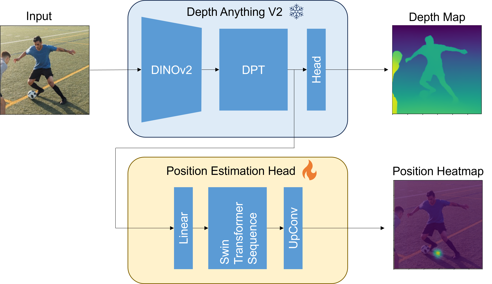

# MyProject

This repository includes code that is **adapted from** [Depth-Anything-V2](https://github.com/DepthAnything/Depth-Anything-V2).

## Install
```bash
git clone https://github.com/shunzoyamagishi/PrecicePersonPosition.git
cd PrecicePersonPosition
pip install -r requirement.txt
git clone https://github.com/DepthAnything/Depth-Anything-V2.git
mv Depth-Anything-V2 Depth_Anything_V2
```
- Download checkpoints from DepthAnythingV2 repogitory and put in "checkpoints" directory.
- Refer to the [Depth-Anything-V2 repository](https://github.com/DepthAnything/Depth-Anything-V2), download the checkpoint file from that repository, and place it in checkpoint directory.

## Model


## Train
```bash
python train.py --config config/default.yaml
```
To train full dataset:
```bash
python train_full.py --config config/default.yaml
```

- `config.yaml` (copy of config file)
- `train.log`
- `events.out.tfevent`
- `checkpoints`  
are saved at `trains/yyyy-mm-dd_hh-mm-ss`.

To check training log:
```bash
tensorboard --logdir=trains/yyyy-mm-dd_hh-mm-ss
```

## Reference
```bash
python reference.py image/video_path --config config/default_reference.yaml
```

## Dataset
To be updated later.


## License

This project follows different licensing conditions depending on the model used:

- **Depth-Anything-V2-Small**  
  Licensed under [Apache License 2.0](https://www.apache.org/licenses/LICENSE-2.0)

- **Depth-Anything-V2-Base / Large / Giant**  
  Licensed under [CC-BY-NC-4.0](https://creativecommons.org/licenses/by-nc/4.0/)  
  (Non-commercial use only)

---

### This Project

If you use this repository with the **Small model**, the project may be used under Apache-2.0.  
If you use this repository with the **Base / Large / Giant models**, the project must follow CC-BY-NC-4.0.
